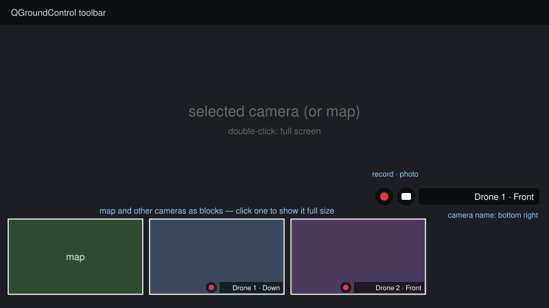

# Multiple Cameras

Multi-camera mode shows several video streams at the same time: more than one camera on a vehicle, cameras on several vehicles, or both.
One item — the selected camera or the map — fills the Fly View; the map (when it is not the full item) and every other camera are shown as blocks of the same size along the bottom left, so nothing is hidden.



## Enabling

Open **Application Settings > Video** and turn on **Multiple camera streams**.
While multi-camera mode is enabled the single-stream **Video Source** setting is not used.

**Maximum streams** (default: 4, range: 1–9) limits how many streams are decoded at the same time.
Every stream is decoded separately, so raise the limit only if the ground station has CPU/GPU headroom.

## Where Streams Come From

_QGroundControl_ combines three sources:

1. **Comm link cameras** — cameras added to a vehicle's comm link in **Application Settings > Comm Links** (see [Cameras of a Comm Link](#cameras-of-a-comm-link)).
   They are shown while that link is connected. This is the recommended way to set up the cameras of each vehicle.
2. **Other camera streams** — a list you enter in **Application Settings > Video > Other Camera Streams**, for cameras that are not tied to a comm link.
3. **MAVLink cameras** — every stream reported with [VIDEO_STREAM_INFORMATION](https://mavlink.io/en/messages/common.html#VIDEO_STREAM_INFORMATION) by any camera on any connected vehicle, including thermal streams.
   _QGroundControl_ requests streaming from each of these cameras (`MAV_CMD_VIDEO_START_STREAMING`) when the stream first appears.

Comm link cameras are taken first, then other camera streams, then MAVLink streams, until **Maximum streams** is reached.
If a stream has the same URL as one taken earlier it is skipped, because two receivers cannot share one UDP port or RTSP session.
Streams are added and removed automatically as vehicles connect and disconnect.

### Cameras of a Comm Link

Open **Application Settings > Comm Links**, edit the vehicle's link (or add a new one) and, below the link settings, press **Add Camera** in the **Cameras** section for each camera of that vehicle.
All settings of one camera are grouped in one box; the fields are the same as for [Other Camera Streams](#other-camera-streams) except that no Vehicle ID is needed.
The **Name** you give a camera is shown in the top left corner of its video, both in the main view and in the camera blocks.

The cameras are saved with the link and shown while the link is connected.
If multi-camera mode is still off, the **Show cameras in the Fly View** switch below the camera list turns it on.

### Other Camera Streams

Each entry of the list describes one stream:

- **Vehicle ID** — MAVLink system ID of the vehicle the camera is on (shown in the stream label).
  Use `0` for a stream that is not tied to a vehicle.
- **Name** — label shown in the top left corner of the video, for example `Front` or `Thermal`.
- **Camera type** — **Dahua**, **Hikvision** or **Uniview (UNV)** to build the stream URL for you (see [Camera Presets](#camera-presets)), or **Custom URL** to enter it yourself.
- **Stream URL** (Custom URL only) — one of:

  | Format | Example |
  | ------ | ------- |
  | RTSP | `rtsp://192.168.1.10:8554/main` |
  | UDP H.264 (RTP) | `udp://0.0.0.0:5600` |
  | UDP H.265 (RTP) | `udp265://0.0.0.0:5601` |
  | MPEG-TS over UDP | `mpegts://0.0.0.0:5602` |
  | TCP MPEG | `tcp://192.168.1.10:5000` |

Press **Add Stream** to add a stream and the trash icon to delete one.
Changes apply immediately; there is no need to restart _QGroundControl_.

::: tip
Give every UDP stream its own port.
A typical two-vehicle, two-camera setup is `udp://0.0.0.0:5600` and `udp://0.0.0.0:5601` for vehicle 1, and `udp://0.0.0.0:5602` and `udp://0.0.0.0:5603` for vehicle 2.
:::

### Camera Presets

For Dahua, Hikvision and Uniview IP cameras and NVRs you do not need to know the RTSP URL.
Select the camera type and fill in:

- **Camera address** — IP address or host name of the camera or NVR, for example `192.168.1.64`.
- **RTSP port** — `554` by default; change it if the camera uses another RTSP port.
- **Login** / **Password** — the camera account (`admin` is pre-filled).
- **Channel** — `1` for a single camera; the camera input number on an NVR.
- **Stream** — **Main stream** (full resolution) or **Sub stream** (lower resolution and bitrate, lighter to decode; useful when many streams run at once).

_QGroundControl_ builds the vendor's RTSP URL and shows it below the fields with the password masked:

| Camera type | RTSP URL (channel 1) |
| ----------- | -------------------- |
| Dahua | `rtsp://<address>:<port>/cam/realmonitor?channel=1&subtype=0` (`subtype=1` for sub stream) |
| Hikvision | `rtsp://<address>:<port>/Streaming/Channels/101` (`102` for sub stream; channel 2 is `201`/`202`) |
| Uniview (UNV) | `rtsp://<address>:<port>/unicast/c1/s0/live` (`s1` for sub stream) |

The login and password are sent to the camera through RTSP authentication and are never written to the log.

::: warning
Camera passwords are stored in the _QGroundControl_ settings file in plain text, like other stream URLs.
Use a dedicated camera account with view-only rights.
:::

## Using the Video View

The bottom left corner holds the picture-in-picture block — the map while a camera is full size, or the selected camera while the map is full size — and every other camera has a block of its own, by default in a column above it (below it when the picture-in-picture block is moved to the upper half).
The column shrinks its blocks when there are many cameras, and the Fly View controls keep clear of it.

- **Show a camera full size** — click its block. If the map was full size, it moves into the picture-in-picture block. Streams keep running while you switch, so there is no reconnect delay.
- **Show the map full size** — click the picture-in-picture block while it shows the map; the selected camera takes its place.
- **Resize** — drag the resize handle (top right) of the picture-in-picture block; the column of camera blocks follows its size. Each camera block has its own resize handle too.
- **Move** — drag the handle (six dots) on the top edge of a block. The picture-in-picture block takes the hidden-cameras button and the column of camera blocks with it; a camera block moves on its own and leaves the column. Places and sizes are remembered per camera. Double-click a camera block's handle to put it back in the column.
- **All cameras HD/SD** — the round **HD/SD** button above the button column switches every preset camera (Dahua, Hikvision, Uniview) to its main stream (**HD**) or sub stream (**SD**) at once; a long press goes back to each camera's own **Stream** setting. Custom URLs are not affected.
- **Hide the blocks** — the arrow button of the picture-in-picture block collapses it, and the camera blocks are hidden with it; the restore button brings them all back.
- **Full screen** — double-click the full-size camera (requires a connected vehicle).
- **Camera name** — shown in bold in the top left corner of the full-size video (right of the tool strip) and of every block; in the picture-in-picture block it is in the bottom right corner, clear of the block's own buttons.

The buttons in a column at the right edge of the full-size video, between the instrument panels (a shorter row at the bottom of each block):

| Button | Action |
| ------ | ------ |
| Red circle | **Record** this stream into its own file; it turns into a square while recording, and a red dot appears next to the name. |
| Camera | **Photo**: save the current frame of this stream (full-size video only). |
| Speaker | **Camera audio** on/off: plays the camera's microphone through the computer's speakers. Dimmed while it connects. |
| Microphone | **Talk** on/off: sends the computer's microphone to the camera's speaker; red while on (full-size video only). |
| Window | **Separate window** (camera blocks only): shows the stream in a window of its own, for example on a second monitor (desktop only). |
| Crossed-out eye | **Remove from the view**: the camera is no longer shown or decoded (remembered across restarts). |

Removed cameras are counted on a button (crossed-out eye and a number) after the camera blocks; its menu shows each removed camera again, or all of them.
A removed camera does not count against **Maximum streams**.

The record and photo buttons are shown once a stream is decoding.
A block shows **WAITING FOR VIDEO** until the first frame arrives, and the view shows **NO CAMERA STREAMS** when no stream is configured or discovered.

### Separate Windows

A stream opened in a separate window keeps its record, photo, audio and talk buttons there, and its block leaves the Fly View (the column closes up).
Close the window to bring the block back. Moving the video to or from a window restarts the stream for a moment, so the button is disabled while that stream records.

### Camera Audio and Talking to the Camera

Audio works for RTSP cameras (the Dahua, Hikvision and Uniview presets and custom `rtsp://` URLs).
_QGroundControl_ opens a second RTSP session to the camera for audio only, so switching audio on or off never interrupts the video.

- **Camera audio** plays the first audio track the camera offers. Enable audio in the camera's own settings (on Dahua/Hikvision/Uniview: the stream's audio or "audio and video" option).
- **Talk** uses the ONVIF audio backchannel (ONVIF Profile T, G.711 μ-law or A-law), which Dahua, Uniview and most current ONVIF cameras support; the camera needs a speaker (or audio output) and ONVIF enabled. Some Hikvision models only offer two-way audio through their own ISAPI protocol, which is not supported.
- Audio uses the system's default microphone and speakers. On Android and macOS the system asks for microphone access the first time.

If the camera has no audio track or no backchannel, the button switches off again and a message names the reason.

### Saved Files

Recordings use the **Record File Format** and storage limit from **Application Settings > Video > Local Video Storage** and are saved in the application's video folder:

```text
<Video folder>/2026-10-22_20.15.03.Vehicle_1_Front.mkv
<Photo folder>/2026-10-22_20.15.07.512.Vehicle_2_Down.jpg
```

The stream label is part of the file name, so recordings from different cameras never overwrite each other.

## Limitations

- Audio is not available for UDP or TCP streams, and recordings contain video only.
- On-screen gimbal control and camera tracking by clicking the video are disabled in multi-camera mode, because the main stream may belong to a vehicle other than the active one.
- Telemetry subtitle files are not written for multi-camera recordings.
- Streams use the shared **Low Latency Mode**, **RTP jitter buffer**, **RTSP timeout** and **auto-reconnect** settings from **Application Settings > Video**.

## Testing Without Hardware

Two SITL vehicles and GStreamer test sources on the ground station are enough to try the feature:

```sh
gst-launch-1.0 videotestsrc pattern=ball ! video/x-raw,width=1280,height=720 ! \
    x264enc tune=zerolatency ! rtph264pay ! udpsink host=127.0.0.1 port=5600
gst-launch-1.0 videotestsrc pattern=smpte ! video/x-raw,width=1280,height=720 ! \
    x264enc tune=zerolatency ! rtph264pay ! udpsink host=127.0.0.1 port=5601
```

Then add `udp://0.0.0.0:5600` (vehicle 1) and `udp://0.0.0.0:5601` (vehicle 2) as manual streams.
